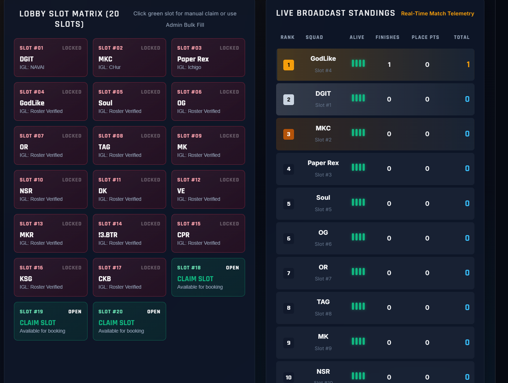
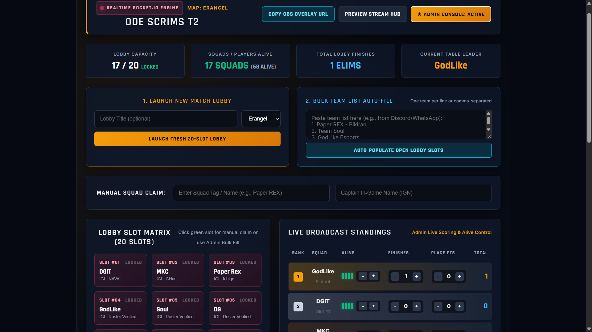
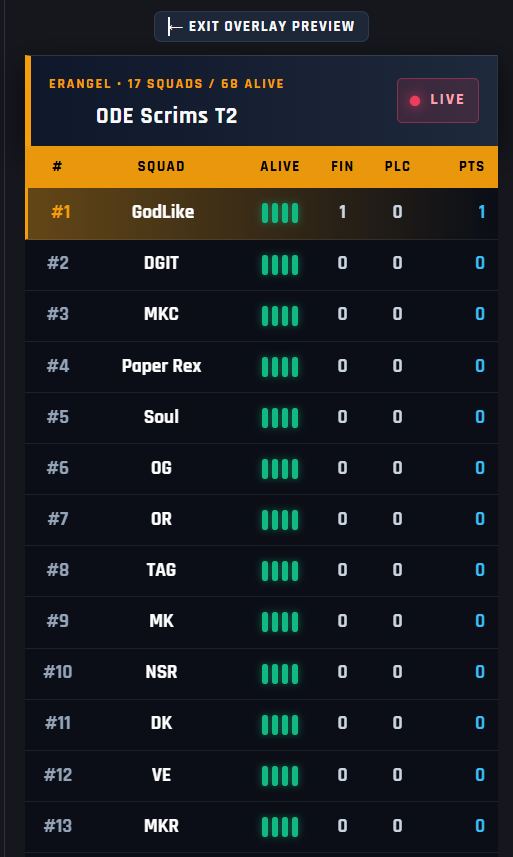

# Real-Time eSports Scrim & Broadcast Manager


A full-stack, real-time tournament lobby and live broadcast HUD platform engineered for competitive **BGMI / Battle Royale T1/T2/T3 scrims**. Built with a **Dual-View WebSocket Architecture**, it combines a **Tactical Command Center** for squad registration and live match scoring with a **Transparent Broadcast Overlay (`?mode=overlay`)** that plugs directly into **OBS Studio** or **Streamlabs**.

## Application Previews

### 1. Tactical Command Center & Live 20-Slot Matrix

*Real-time 20-slot lobby matrix alongside the auto-sorted broadcast standings table and live telemetry strip.*

### 2. Admin Console: Bulk Squad Auto-Fill & 4-Player Alive Controls

*Organizer mode featuring one-click WhatsApp/Discord team list auto-import, rapid `+/-` kill & placement steppers, and live 4-player squad alive status controls.*

### 3. Transparent OBS Studio Broadcast Overlay (`?mode=overlay`)

*Transparent broadcast tower rendered inside OBS Studio over live gameplay, featuring dynamic 4-bar squad alive indicators and real-time point sorting.*

## Core Engineering Highlights

* **Atomic Concurrency Control (Zero Double-Booking):** Uses MongoDB atomic `findOneAndUpdate` operations (`$elemMatch` + positional `$set`) so that if 15 squad captains click the same open slot within the same millisecond, only the first request locks the slot while all other clients receive an instant lock broadcast.
* **Hybrid Squad Registration (Bulk Import + Manual Claim):** Organizers can paste a raw numbered list of teams from Discord/WhatsApp to auto-populate open slots in one click, while still allowing individual captains to manually claim remaining open slots.
* **Live 4-Player Squad Alive Telemetry:** Tracks active players per squad (`0–4`) using glowing broadcast status bars (`||||` active, amber last-man-standing alert, and automatic `WIPED` badge + row dimming when a squad is eliminated).
* **Sub-50ms OBS Broadcast Synchronization:** Uses room-isolated Socket.io events (`join_scrim_room`) to push finishes, placement points, and player knock/elimination updates directly to the live stream overlay without refreshing the browser source.

## How to Use in OBS Studio for Live eSports Streams

Professional eSports broadcasts overlay HTML/WebSocket graphics directly on top of live gameplay using **OBS Browser Sources**. Follow these steps to run a live match broadcast:

### Step 1: Launch the Platform & Populate Teams
1. Open the dashboard at `http://localhost:5173`.
2. Click **Organizer Login / Mode** in the top right to enable Admin Controls.
3. Select the match map (**Erangel**, **Miramar**, **Sanhok**, or **Vikendi**) and click **Launch Fresh 20-Slot Lobby**.
4. Paste your confirmed lobby list into **Bulk Team List Auto-Fill** (or let captains claim slots manually) to populate the 20 slots.

### Step 2: Copy the Stream Overlay URL
1. Click the **Copy OBS Overlay URL** button in the top navigation bar.
2. This copies `http://localhost:5173/?mode=overlay` to your clipboard.
   *(Tip: You can also click **Preview Stream HUD** in the navbar to inspect the overlay layout directly in your browser).*

### Step 3: Configure OBS Studio Browser Source
1. Open **OBS Studio** (or Streamlabs Desktop) where your game capture or clean feed is running.
2. In the **Sources** dock, click the **`+`** button and select **Browser**.
3. Name the source **`Live Scrim Standings HUD`** and click **OK**.
4. Enter the following exact properties in the Browser Source window:
   * **URL:** `http://localhost:5173/?mode=overlay`
   * **Width:** `430`
   * **Height:** `750`
   * **Custom CSS:** Leave default (`body { background-color: rgba(0, 0, 0, 0); margin: 0px auto; overflow: hidden; }`)
5. Click **OK** and position the transparent standings tower on the right or left side of your 1080p stream canvas.

### Step 4: Live Match Production Workflow
1. Keep the main dashboard (`http://localhost:5173`) open on a second monitor (or another laptop on the same network) with **Admin Console: ACTIVE**.
2. **During Gunfights:** When a player is eliminated from a squad, click the **`-`** button under their **Alive** column. The OBS stream overlay immediately updates their 4-bar indicator and decrements the header's total **ALIVE** counter.
3. **Awarding Finishes & Placement Points:** Click **`+`** under **Finishes** or **Place Pts** as kills happen. The OBS overlay automatically re-sorts the Top 20 standings in real time (`<50ms` latency).
4. **Squad Wipe:** When a squad's alive count hits `0`, the overlay automatically badges them as **`WIPED`** and dims their row so viewers can easily see which teams are still fighting for the Chicken Dinner.

## Local Installation & Setup

### Prerequisites
* **Node.js** (v18+ or v24+)
* **MongoDB Atlas** URI (or local MongoDB instance)

### 1. Clone the Repository
```bash
git clone [https://github.com/Bikiran007/esports-scrim-manager.git](https://github.com/Bikiran007/esports-scrim-manager.git)
cd esports-scrim-manager